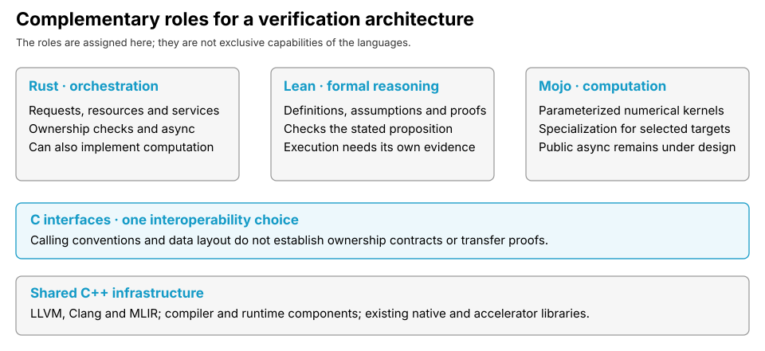
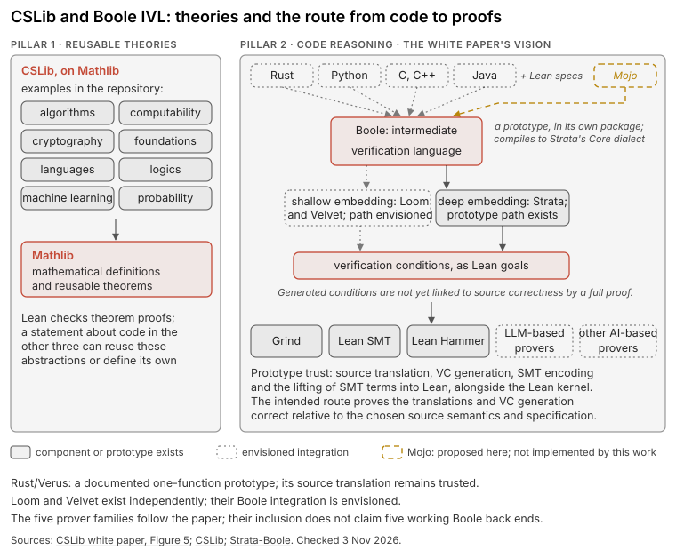
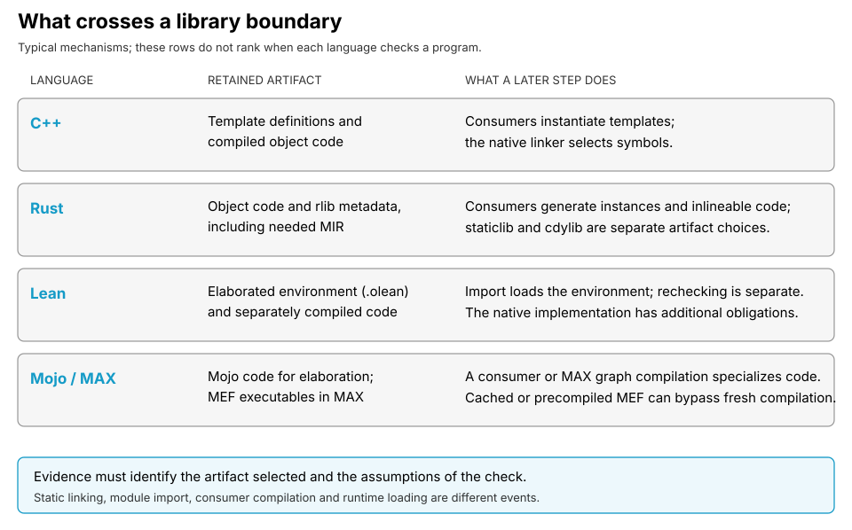
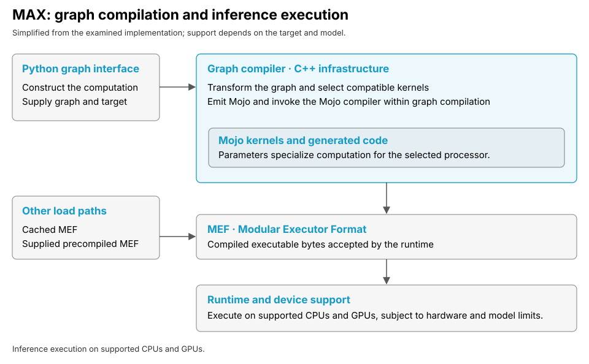

<!-- Introduction to the Babel series. Figures in diagrams/. -->
# Gang of four: C++, Rust, Lean and Mojo

*Software verification must connect a stated requirement to the program that actually executes, including its dependencies. We examine C++, Rust, Lean and Mojo through linking and loading, metaprogramming and the ecosystem. Hybrid analysis connects static reasoning with observed execution, and partial evaluation specializes programs using information already available. This introduction states the questions that the language essays answer.*

**This essay introduces a series on software verification, assuming familiarity with programming languages and compilers.** Our concern is how a property survives specialization, compilation and composition across languages. A compiler can reject a type error without proving the algorithm, and a proof can establish a statement without establishing that the executable implements it.

AI systems already generate candidate programs and formal proofs, so the distinction between generation and acceptance is practical. *Generative Compilation* obtains compiler feedback while Rust programs are generated, and *LeanDojo* connects language-model proof search to Lean's proof environment. Neither establishes that generated software is generally correct. [1, 2]

We select these four languages to study high-performance systems through native execution, compiler specialization and formal reasoning. C++, Rust and Mojo implement such systems in complementary ways, and Lean expresses specifications and supports proofs. Java, Python, TypeScript, Go, Zig and OCaml remain part of the heterogeneous setting of this series. We write C/C++ only where a claim applies to both.

## 1. The position and three challenges

Our position assigns complementary responsibilities rather than requiring every component to use one language. C++ provides foundational native libraries and compiler infrastructure, Rust implements orchestration, and Mojo specializes numerical computation. Lean expresses definitions and properties for formal reasoning, including models of programs written elsewhere. Figure F1 shows these roles without implying that the four already form a verified implementation.

The **control plane** selects work, manages resources and records the conditions under which execution proceeds. The **data plane** performs the selected computation, including numerical kernels on supported processors. These are roles we assign, not standard classifications: Rust can compute, and Mojo's design extends beyond kernels.

**Challenge 1. An analysis may examine a different program from the one selected for execution.** Libraries can be linked, loaded or compiled after an earlier check. *The linking-and-loading axis therefore tracks which implementation was selected, with which inputs and configuration, and when the evidence applies.*

**Challenge 2. A generic definition and a specialized instance have different checking obligations.** Type checking, compile-time evaluation and code generation do not establish interchangeable facts. *The metaprogramming axis therefore asks what is checked before specialization, what remains dependent on values, and what must be checked afterward.*

**Challenge 3. A property established in one language needs justification when another component uses it.** Calling conventions do not carry ownership rules or logical proofs. *The ecosystem axis therefore identifies the adapters, translations and assumptions needed to relate results across the boundary.*

## 2. Four languages on their own terms

**C++ provides foundational infrastructure for native systems and the compilers used to implement them.** LLVM, Clang and MLIR support compilation, and CUDA libraries such as CUTLASS provide established accelerator implementations. The Mojo compiler and MAX graph compiler also contain substantial C++ components, although rustc uses Rust and Lean's front end uses Lean. [3, 4]

C++ templates specialize code after arguments become available, with dependent checks performed on the resulting instances. Concepts constrain arguments without proving that a body uses only the operations those constraints require. A type-correct program can still have undefined behaviour, so compilation success alone establishes neither memory correctness nor the intended functional property. We prefer Rust or Mojo for suitable new components while retaining required C/C++ dependencies. [5]

**Rust combines native execution with ownership checks and an established asynchronous programming model.** Its borrow checker analyzes the mid-level intermediate representation, MIR, before native code generation, and monomorphization generates specialized code for each concrete use of a generic body. Its memory guarantees depend on the contracts around `unsafe` code and foreign implementations: a Rust caller can invoke an incorrectly implemented foreign function despite passing Rust's checks. Verification must cover that function's contract and the adapter that transfers its arguments. [6, 7, 8]

**Lean provides a language for definitions, specifications and proofs, with a kernel that checks proof terms.** An accepted proof establishes its elaborated statement under the definitions and axioms it uses, not that the statement expresses the author's intended requirement. Lean's compiler and runtime are separate from proof checking, so imported environments, external functions and native evaluation each add conditions to a result. [9, 11]

Mathlib provides reusable definitions and theorems that proof-search systems such as LeanDojo's ReProver retrieve when constructing candidate proofs. [CSLib](https://github.com/leanprover/cslib) develops computer-science theories and prototype infrastructure for reasoning about programs written in other languages. Figure F2 distinguishes CSLib's theories from the code-reasoning vision and the Boole/Strata prototype. CSLib's contributing guide calls the translation "not fully foundational" and the connecting metatheorem "a major long-term goal", so a proved generated condition depends on the translation and condition generator being sound. [2, 10]

**Mojo specializes numerical code for heterogeneous hardware through a compiler built around MLIR.** The Multi-Level Intermediate Representation (MLIR) framework represents programs at several abstraction levels. Mojo parameters provide typed compile-time values for specialization, including specialization for a selected target, and MAX uses Mojo kernels within its graph-compilation system. On 22 October 2026, Modular released the source of MAX's graph compiler, runtime and device extensibility components, which Figure F5 in Section 5 summarizes. [4, 12]

Mojo's maturity limits which surrounding services we can assume today. Its [async proposal](https://github.com/modular/modular/blob/main/Mojo/proposals/async-design.md) describes unfinished internal support, and the examined built-in targets do not include WebAssembly. These are availability limits, not claims that the language can never support those uses. [13, 14]

## 3. Linking and loading

Linking and loading determine which implementation an earlier result can describe. Static linking selects code before execution, dynamic loading can introduce a library after execution begins, and just-in-time compilation generates code when a running system requests it. Figure F3 separates these events instead of treating every import or crate boundary as runtime loading.

C++ compiles translation units separately, and the linker resolves symbols across their object files. The one-definition rule constrains repeated definitions, but violations outside the specified diagnostic cases need not be reported, so an analysis of one candidate body needs an account of which body linking retained. [5]

Rust libraries can retain object code and compiler metadata in an rlib, from which consumers generate code for generic instances. A `staticlib` or `cdylib` selects a different artifact for interoperability, and producing it does not verify the contract of its foreign callers. [6, 7]

Lean's module import loads a cached environment from an `.olean` file rather than re-executing every source command. A foreign-function declaration refers to an implementation outside the kernel's inspection, so the imported theorem and the linked executable require distinct evidence. [9, 11]

Mojo packages retain code for elaboration by a consumer, whose build specializes it for the selected target. MAX can also compile Mojo during graph compilation within a running process, or load a cached or precompiled model instead, so evidence must identify the path taken. [15, 16]

A deployable verification result must therefore name the source, dependencies, compiler configuration, target and representation that the checker examined. Runtime observation establishes which artifact was selected, not that a source-level proof covers an unchecked translation.

## 4. Metaprogramming and partial evaluation

Partial evaluation specializes a program using the inputs already known, leaving a residual program for the remaining inputs. A matrix kernel, for example, can fix its element type and dimensions while receiving matrix values later. Correct specialization preserves the original program's meaning under the stated assumptions, but it does not establish that the original program met its specification. [17]

Figure F4 separates specialization from verification and relates both to runtime observation. A compiler can remove decisions whose inputs are fixed, but fewer runtime decisions do not constitute a correctness proof.

Metaprogramming is broader than partial evaluation, because it includes programs that construct or transform other programs. C++ templates, Rust macros, Lean metaprograms and Mojo parameters act at different stages on different representations, and treating them as one mechanism would hide the conditions a verifier needs. Compile-time computation also has an execution context of its own, since Rust procedural macros and Lean metaprograms can perform input and output. [5, 7, 12, 18]

Generic-body checking also differs from checking a particular compile-time value. Rust can accept a generic body against its trait bounds and later reject a value-dependent constant during code generation, and `cargo check` omits that final stage. Lean makes some conditions explicit as propositions that callers must prove, C++ enforces dependent conditions at instantiation, and Mojo evaluates parameter-dependent conditions while elaborating a use. A proof obligation, a constant assertion and a type constraint are not interchangeable merely because each can reject a program. [6, 19]

Mojo parameters express compile-time choices, including element types and vector widths, within ordinary definitions. The [Parametric Operations (POP) dialect](https://github.com/modular/modular/blob/b2d6b83ba7e17ddaf1c31acdf926c25194e44b2a/Mojo/docs/stdlib/internal/pop_dialect.md#L5-L20) represents operations whose types or attributes still depend on those parameters, and elaboration resolves them into concrete operations before lowering toward LLVM IR. For compiler details see the [passes and representations manual](https://github.com/modular/modular/blob/main/Mojo/docs/compiler/manual/PassesAndIR.md) and the [original design overview](https://github.com/modular/modular/blob/main/Mojo/docs/compiler/DesignOverview.md). [12]

Hybrid analysis connects static models with observations of particular executions. Static reasoning may assume a buffer length or target capability, and runtime checks test those conditions at selected boundaries. A contradicted assumption invalidates the earlier result until the system re-establishes the condition or selects another implementation.

## 5. The ecosystem and future directions

The compilation infrastructure connects these languages without composing their verification guarantees. Clang lowers C++ to LLVM IR, rustc's default backend targets LLVM, Mojo uses MLIR before LLVM lowering, and Lean's compiler emits C for a native compiler. Sharing a backend does not show that ownership rules or logical properties survive every intervening lowering. [3, 6, 11, 12]

CUDA Rust offers two experimental NVIDIA routes: cuda-oxide lowers Rust MIR through pliron and LLVM to PTX, and cutile-rs compiles tile computations through CUDA Tile IR. Pliron is a separate framework inspired by MLIR, not part of rustc's default compilation. MAX supports CPUs and GPUs from NVIDIA, AMD and Apple, and later essays compare CUDA Rust, particularly cutile-rs, with MAX through their designs and measured performance. [20, 25]

Figure F5 shows how MAX compiles a graph and executes the resulting model. The graph compiler combines operations and compiles generated Mojo alongside kernel implementations for the selected target. The Modular Executor Format (MEF) carries the compiled model to GraphRT, the executor of the Modular Low-level Runtime (MLRT), whose Driver manages device memory and kernel execution. At ModCon in August 2026, members of the Modular team told me they were working on training, and a unified platform for inference and training is a direction we examine later in this series. [4, 16, 21]

Existing verification connections demonstrate narrower composition. Aeneas translates a supported subset of Rust through Charon into functional programs, including Lean definitions, but its fragment excludes unsafe code and concurrency. Cedar implements its authorization engine in Rust, proves properties in a Lean model, and compares the two by differential randomized testing, which supplies evidence of agreement without proving equivalence for every input. CXX checks Rust–C++ signatures and generates adapters, but ownership transfer, buffer validity and failure handling remain contracts that the implementation and its users must satisfy. [8, 22, 23]

Lean-MLIR formalizes intermediate languages and proves selected rewrites. We propose to examine selected Mojo and MAX representations in the same way, which requires stating their semantics and proving that particular translations preserve the properties under consideration. Figure F6 compares the compilation routes and separates native code generation from logical proof checking. [3, 6, 11, 12, 20, 24]

## 6. What exists today, and what remains to establish

Table 1 separates available mechanisms from experiments and from the obligations of our proposed composition. The distinctions concern particular tools and language fragments, not a ranking of languages.

| Language | Available basis | Limits and next steps |
|---|---|---|
| C/C++ | Native libraries, C interfaces, LLVM infrastructure and existing analysis tools. | C and C++ need different reasoning. Undefined behaviour and foreign contracts remain obligations. |
| Rust | Ownership checks, async, native and WebAssembly targets, and verification tools for specific fragments. | CUDA Rust provides cuda-oxide and cutile-rs for NVIDIA GPUs. Later essays compare these routes with MAX's support across GPU vendors. |
| Lean | Kernel-checked proofs, Mathlib, CSLib theories and existing Rust-to-Lean translation research. | Proof assumptions and executable correspondence remain explicit. CSLib's code-reasoning prototype is not fully foundational. |
| Mojo | Parameter specialization, MLIR compilation and MAX inference kernels for supported hardware. | Public async is under design. The built-in targets examined omit WebAssembly. Training remains a development direction. |

The proposed composition must relate these results rather than collect them. A property about a logical model needs a justified connection to the code selected at runtime, and an adapter must preserve the contract assumed on each side. The remaining essays develop this argument through C++, Rust, Lean and Mojo, then consider their composition, as a programme rather than an accomplished result.

Next in the series: Part 2, C++: The Foundational Infrastructure.

## References

1. N. Mündler-Sasahara et al., *Generative Compilation: On-the-Fly Compiler Feedback as AI Generates Code*, 2026. [Paper](https://arxiv.org/abs/2607.13921).
2. K. Yang et al., *LeanDojo: Theorem Proving with Retrieval-Augmented Language Models*, NeurIPS 2023. [Paper](https://arxiv.org/abs/2306.15626).
3. LLVM, [project overview](https://llvm.org/), [Clang](https://clang.llvm.org/), and [MLIR](https://mlir.llvm.org/). NVIDIA, [CUTLASS](https://github.com/NVIDIA/cutlass). Clang, [optional ClangIR](https://clang.llvm.org/docs/CIR/index.html).
4. Modular, [repository overview at the examined revision](https://github.com/modular/modular/blob/b2d6b83ba7e17ddaf1c31acdf926c25194e44b2a/README.md) and [graph compiler architecture](https://github.com/modular/modular/blob/b2d6b83ba7e17ddaf1c31acdf926c25194e44b2a/GraphCompiler/docs/ArchitectureSpecification.md); [stack diagram redrawn in Figure F3](https://github.com/modular/modular/blob/b2d6b83ba7e17ddaf1c31acdf926c25194e44b2a/GraphCompiler/docs/High-Level_Modular_Stack_Diagram.png); [graph-compiler documentation](https://github.com/modular/modular/blob/main/GraphCompiler/docs/GraphCompiler.md); [Modular 26.7 release announcement, 22 October 2026](https://www.modular.com/blog/26-7).
5. C++ working draft: [template instantiation](https://eel.is/c++draft/temp.inst), [constraints](https://eel.is/c++draft/temp.constr), [constant expressions](https://eel.is/c++draft/expr.const), and [one-definition rule](https://eel.is/c++draft/basic.def.odr), and [undefined behaviour](https://eel.is/c++draft/defns.undefined).
6. Rust Compiler Development Guide: [overview](https://rustc-dev-guide.rust-lang.org/overview.html), [MIR borrow checking](https://rustc-dev-guide.rust-lang.org/borrow-check.html), [monomorphization](https://rustc-dev-guide.rust-lang.org/backend/monomorph.html), and [libraries and metadata](https://rustc-dev-guide.rust-lang.org/backend/libs-and-metadata.html), and [stable async](https://blog.rust-lang.org/2019/11/07/Async-await-stable.html).
7. Rust Reference: [undefined behaviour](https://doc.rust-lang.org/reference/behavior-considered-undefined.html), [linkage](https://doc.rust-lang.org/reference/linkage.html), and [procedural macros](https://doc.rust-lang.org/reference/procedural-macros.html), [trait bounds](https://doc.rust-lang.org/reference/trait-bounds.html#bound-satisfaction), and [platform support](https://doc.rust-lang.org/nightly/rustc/platform-support.html).
8. CXX, [overview](https://cxx.rs/) and [extern C++ contracts](https://cxx.rs/extern-c++.html).
9. Lean Language Reference, [Validating a Lean Proof](https://lean-lang.org/doc/reference/latest/ValidatingProofs/).
10. [Mathlib](https://github.com/leanprover-community/mathlib4); [CSLib contributing guide](https://github.com/leanprover/cslib/blob/e37c15a8320f4c6ece5750c1447ec499755ff00e/CONTRIBUTING.md); [CSLib white paper, Figure 5](https://arxiv.org/html/2602.04846v1#S2.F5); [Strata-Boole prototype and trust boundaries](https://github.com/strata-org/Strata-Boole/blob/6275012048e92d6d7e02052866a73de47e654ad8/README.md); [documented Rust/Verus example](https://github.com/strata-org/Strata-Boole/blob/e7db2ebc969861c558cdad8191fe23899bb646d3/DALEK_BENCHMARK.md).
11. Lean Language Reference: [elaboration and compilation](https://lean-lang.org/doc/reference/latest/Elaboration-and-Compilation/), [source files and modules](https://lean-lang.org/doc/reference/latest/Source-Files-and-Modules/), and [foreign-function interface](https://lean-lang.org/doc/reference/latest/Run-Time-Code/Foreign-Function-Interface/), and [bundled native toolchain](https://lean-lang.org/doc/reference/latest/Build-Tools-and-Distribution/).
12. Mojo, [parameterization](https://mojolang.org/docs/manual/parameters/) and [compiler passes and representations](https://github.com/modular/modular/blob/b2d6b83ba7e17ddaf1c31acdf926c25194e44b2a/Mojo/docs/compiler/manual/PassesAndIR.md).
13. Mojo, [async design proposal](https://github.com/modular/modular/blob/main/Mojo/proposals/async-design.md), draft dated 1 October 2026. [Examined revision](https://github.com/modular/modular/blob/b2d6b83ba7e17ddaf1c31acdf926c25194e44b2a/Mojo/proposals/async-design.md).
14. Mojo, [system requirements](https://mojolang.org/docs/requirements/) and [roadmap](https://mojolang.org/docs/roadmap/). At the examined revision: [host targets](https://github.com/modular/modular/blob/b2d6b83ba7e17ddaf1c31acdf926c25194e44b2a/Mojo/lib/Target/Host/HostTraits.h#L25-L29) and [registered-target filtering](https://github.com/modular/modular/blob/b2d6b83ba7e17ddaf1c31acdf926c25194e44b2a/Mojo/tools/mojo/Build/mojo-build.cpp#L163-L176).
15. Mojo, [packages](https://mojolang.org/docs/manual/packages/).
16. Modular at the examined revision: [graph compilation](https://github.com/modular/modular/blob/b2d6b83ba7e17ddaf1c31acdf926c25194e44b2a/GraphCompiler/lib/GraphCompiler.cpp#L478-L623), [MEF cache](https://github.com/modular/modular/blob/b2d6b83ba7e17ddaf1c31acdf926c25194e44b2a/GraphCompiler/lib/FrameworkFrontend/FrameworkFrontend.cpp#L425-L458), and [precompiled models](https://github.com/modular/modular/blob/b2d6b83ba7e17ddaf1c31acdf926c25194e44b2a/max/lib/max_license/API/c/CompiledModels.cpp#L100-L154); [MLRT components and responsibilities](https://github.com/modular/modular/blob/b2d6b83ba7e17ddaf1c31acdf926c25194e44b2a/MLRT/docs/README.md#L5-L60); [Modular Executor Format specification](https://github.com/modular/modular/blob/b2d6b83ba7e17ddaf1c31acdf926c25194e44b2a/MLRT/docs/GraphRT/ModularExecutorFormat.md#L1-L5).
17. N. D. Jones, C. K. Gomard and P. Sestoft, *Partial Evaluation and Automatic Program Generation*, 1993. [Authors' book page](https://raspi.itu.dk/people/sestoft/pebook/).
18. *Metaprogramming in Lean 4*. [Book](https://leanprover-community.github.io/lean4-metaprogramming-book/).
19. Cargo, [cargo check](https://doc.rust-lang.org/cargo/commands/cargo-check.html).
20. NVIDIA, [CUDA Rust programming models](https://github.com/NVIDIA/cuda-rust/blob/9df9e7cef561e03a066230b3bb433b3d8285da81/README.md#L8-L46), [cutile-rs](https://github.com/NVIDIA/cuda-rust/blob/9df9e7cef561e03a066230b3bb433b3d8285da81/cutile-rs/README.md), [cuda-oxide at the examined revision](https://github.com/NVIDIA/cuda-rust/blob/9df9e7cef561e03a066230b3bb433b3d8285da81/cuda-oxide/README.md) and [optional MLIR export](https://github.com/NVIDIA/cuda-rust/blob/9df9e7cef561e03a066230b3bb433b3d8285da81/cuda-oxide/crates/cuda-oxide-mlir-export/README.md). [pliron](https://github.com/pliron-org/pliron/blob/aa39c9b1adfe5f251a0aad102d96979021af164f/README.md); [cutile-rs compiler and Tile IR](https://github.com/NVIDIA/cuda-rust/blob/9df9e7cef561e03a066230b3bb433b3d8285da81/cutile-rs/cutile-compiler/src/lib.rs#L1-L10).
21. Modular forum, [training plans after the experimental interface](https://forum.modular.com/t/first-class-autodiff-training-in-max-timeline-and-supersede-or-compose-with-community-autograd-libraries/3152), team reply dated 5 June 2026. The August 2026 ModCon conversation is the author’s recollection of a personal discussion.
22. [Aeneas](https://github.com/AeneasVerif/aeneas/blob/505b6ca35217e7be5c96c3e2f8045edfbdf47291/README.md#L122-L150), supported fragment and verification approach; [Charon](https://github.com/AeneasVerif/charon), extraction from Rust.
23. Cedar, [Lean specification and differential testing](https://github.com/cedar-policy/cedar-spec).
24. S. Bhat et al., *Verifying Peephole Rewriting in SSA Compiler IRs*, ITP 2024. [Paper](https://arxiv.org/abs/2407.03685); [Lean-MLIR](https://github.com/opencompl/lean-mlir).
25. Modular, [MAX hardware compatibility](https://max.modular.com/gpu/hardware-compatibility/) and [model-serving requirements](https://max.modular.com/system-requirements/).
