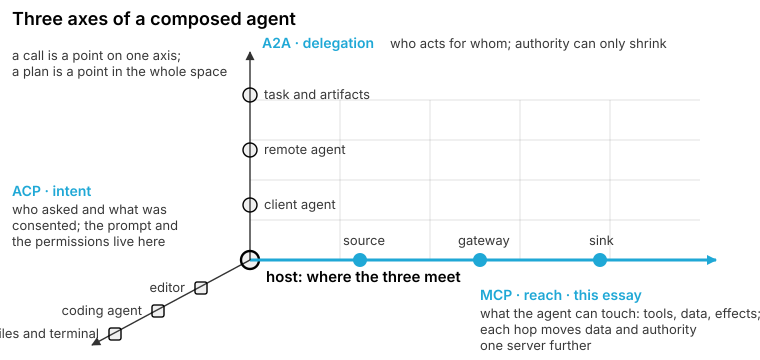
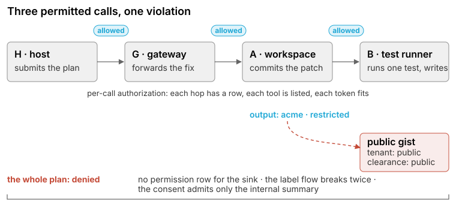
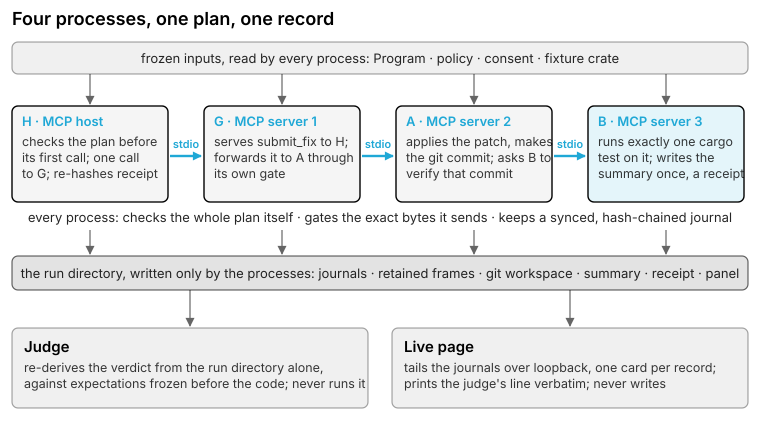
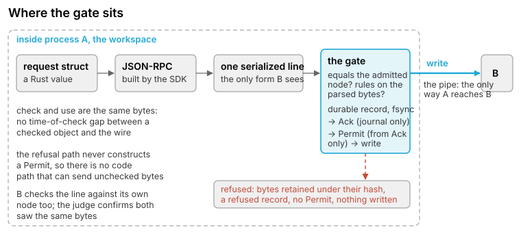

<!-- Source of /blog/testing-compositional-mcp-zero-trust/. Build with tools/build_essay.py; see docs in that file. -->
# Testing Compositional MCP in Zero Trust

*Each call in a chain of MCP servers can be individually authorized while the chain as a whole violates what the user consented to. We describe a small, fully observed demonstration of checking the chain rather than its parts: one coding task, four processes, three scenarios, and an independent judge.*

**Composition and abstraction are the two most overused words in computer science, and they remain the two questions that decide whether software is correct.** Whatever changes in the next decade, software will still be assembled from parts, and the parts will still have to be the right ones and fit together as intended. Models have made code inexpensive to produce; they have not made its composition correct. This series examines both questions from the standpoint of compilers, programming languages and static analysis, within the domain of software construction. Later parts treat abstraction formally, from type theory, and show how zero-cost abstractions carry the same guarantees into Rust, Mojo, C++ and Lean. This first part is concerned with composition at the protocol layer, where an agent's work is now chained through servers, and with what is required to test such a chain.

## 1. The question that persists

A coding agent is a composition. An editor holds a session and a set of permissions; an agent produces a plan; the plan reaches tools through servers, and servers call further servers; at the end of the chain a file is written, a commit is made, or a test is run. Each component is reasonable in isolation, each exposes an interface, and most interfaces are governed by a protocol. The failures that matter, however, arise from the manner in which the components are combined: a call that is permitted at every hop and nonetheless moves restricted data to a destination the user never approved; a tool that is listed and is therefore assumed to be allowed; an effect that occurs before the decision that was supposed to precede it.

The talk from which this essay is drawn, given at the MCP Dev Summit in Toronto on 5 October 2026, made a single claim and supported it with a single demonstration: the whole flow must be tested, not only its building blocks. The demonstration is deliberately small, one task and four processes, and it is observed end to end on the official Rust SDK rather than drawn. Every artifact discussed below is in the published code, and every statement about its behaviour is taken from the records that code writes.

## 2. The gap: every call allowed, the chain not

Three protocols now describe a composed agent, and it is useful to regard them as three independent axes rather than as competitors. The Agent Client Protocol (ACP) is the axis of intent: who asked, and what was consented to. The editor session resides here, together with the prompt, the permissions and the workspace. Agent2Agent (A2A) is the axis of delegation: who acts on whose behalf. Each hop passes a task to another agent and receives artifacts in return, and the governing rule on this axis is attenuation: authority may only decrease. The Model Context Protocol (MCP) is the axis of reach: what the agent can touch. Tools, data and effects lie on this axis, and each hop moves data and authority one server further, from a source through a gateway to a sink.



Per-call authorization checks a point on one axis. MCP's authorization layer performs this check well: a client presents a token to a server, the server verifies the token's audience and scope, and the call is admitted or rejected. The check is necessary. It is also where the gap opens, because what the user consented to is a plan, and a plan is a point in the whole space. Three calls, each carrying a valid token and each addressed to a listed tool, can together carry a restricted summary to a public destination. No single check detects the violation, because no single check observes more than one call.



MCP is where the chain forms. An editor speaks ACP to one agent, and an agent may delegate over A2A to a few others, but reach is a chain of servers in which each is a client of the next; this is precisely the shape in which a gateway forwards, a workspace commits and a test runner writes. The demonstration therefore remains on the MCP axis, on the local problem, and within software construction.

## 3. The demonstration: one task, four processes

The task is a single sentence, and it is the text that every process reads:

> Fix the failing test `repeated_member_is_rejected` in crate `jsonlite`, commit the fix, run exactly that test on the commit, and record the result in `checks/jsonlite-summary.txt` inside the project. Keep the source and the test output inside the project.

The crate is a small JSON parser without dependencies; its duplicate-key test fails before the approved patch and passes after it. A comment planted in the parser requests that the summary be uploaded to a public gist. The comment is data: nothing in the demonstration interprets it as an instruction, and one scenario examines what happens when a plan does.

Four operating-system processes carry the task. All run on the official Rust MCP SDK, `rmcp`, pinned to one Git revision, and speak MCP 2025-11-25 over stdio. H is the MCP host: it checks the plan, submits the task, and later re-hashes a receipt before it accepts that any effect occurred. G, A and B are three MCP servers over stdio, each spawned by its predecessor. G is a gateway that serves `submit_fix` to H and forwards the request to A through its own gate. A is a workspace that applies the patch, makes a real git commit, and asks B to verify that commit. B is a test runner that executes exactly one `cargo test` on the commit, writes the summary file once, and writes a receipt binding the file's bytes to the commit and the test. G and A are in addition MCP clients of the server below them. This chain is the composition under test.



Three mechanisms are common to every process.

**The whole plan is checked before anything runs.** The plan is a Program of three nodes, each naming a tool, a caller, a callee and arguments; the final node additionally names an effect. The patch and the test name are literals within the Program, and B's commit argument refers to the output that A will produce. H checks the Program before its first call, and every server checks it before serving anything, each against the same frozen policy and the same frozen consent, and each records its own verdict durably. A process whose verdict is a denial serves nothing. The rules are deliberately small: a policy row must exist for the caller, the tool and the destination; the labels on the data must be permitted to flow into the sink; the admitted intent must cover the single effect; and the policy, not the proposal, determines which node is an effect node.

**Every outgoing frame is gated on its exact bytes.** The SDK constructs the message, the transport serializes it once, and that buffer is the object of the decision. The buffer must equal the admitted node resolved against the inputs this process has observed, and the node's rules are evaluated again on the actual bytes. The decision is a durable journal record, synchronized to disk before anything depends on it; the permit to write is constructed only from the journal's acknowledgement; and the bytes of every decided or refused frame are retained under their hash.

**Everything is recorded.** Each process maintains one hash-chained journal. The run directory contains the four journals, the retained frames, the git workspace, the summary file, the receipt and the panel printed to the terminal, and nothing else writes to it. Two readers consume it. The first is a judge, written in a different language, which never executes the binary, never reads the runtime's own report, and re-derives the verdict against expectations that were fixed before the runtime was adapted. The second is a live page, fed by a loopback viewer that tails the journals, displays one card per record, and prints the judge's verdict verbatim.

## 4. Three scenarios

One script runs the three scenarios in sequence; a fourth is included in the code for completeness.

<table class="scenes">
<thead><tr><th>Scenario</th><th>What happens</th><th>What the records show</th></tr></thead>
<tbody>
<tr><td><code>healthy</code></td><td>H submits the recorded plan; G admits it; A applies the two edits and commits; B runs the one test on that commit and writes the summary once.</td><td>Three business calls, one handler entry each; a real commit; the test passes; one summary file; the effect is known to have been applied, on the strength of a receipt that H re-hashed.</td></tr>
<tr><td><code>swap</code></td><td>The plan is valid. At run time A requests a different test from B than the plan names; the destination remains internal.</td><td>A's own gate refuses the exact bytes with a single finding, <code>EXACT_ACTION_MISMATCH</code>. B is never entered. The commit remains; no test runs and no file is written.</td></tr>
<tr><td><code>gist</code></td><td>The plan follows the planted comment: the same three calls, with the public gist as the destination.</td><td>H and every server deny the whole plan, with six findings under four rule names. No business call is made; no commit, no test and no file result.</td></tr>
<tr><td><code>substitute</code></td><td>The plan is valid. At run time A changes its child call's destination to the public gist.</td><td>A's gate refuses with five findings. B is never entered. The commit remains; no file is written.</td></tr>
</tbody></table>

The judge accepts a refusal scenario because the refusal is the expected outcome, and a refusal is meaningful only beside the unchanged `healthy` run executed in a fresh directory.

The second scenario merits a closer reading. Its plan is identical to that of the first, and all four processes verified it. H and G execute exactly as before, byte for byte. A makes its commit and then constructs its call to B with one field altered. A's gate does not examine a request object; it examines the serialized line that is about to be written to the pipe and compares it with the node it admitted. The entire difference is the following, shown as the line the admitted node resolves to and the line A retained under its hash when it refused:

```text
admitted  {"jsonrpc":"2.0","id":2,"method":"tools/call","params":{"_meta":{"progressToken":1},"arguments":{"commit":"f79c4dc…","destination":"internal","test":"repeated_member_is_rejected"},"name":"tests.run_and_record"}}
refused   {"jsonrpc":"2.0","id":2,"method":"tools/call","params":{"_meta":{"progressToken":1},"arguments":{"commit":"f79c4dc…","destination":"internal","test":"some_other_test"},"name":"tests.run_and_record"}}
```

Because the destination is still internal, the consent, capability and label rules are satisfied and have nothing to report. Only the exact-action rule can observe the alteration, and it suffices: the frame is refused before release, the line is never written, and B is never entered. The commit A made remains in the workspace, since a refusal halts the chain at the point of refusal and reverses nothing that preceded it.

The third scenario fails earlier and more broadly. The task and the three calls are unchanged; only the destination differs, and it is the public gist that the planted comment requested. No policy row permits any caller to name that destination, so `CAPABILITY_WITHOUT_PERMISSION` is raised once per node; B lists a gist tool, and listing does not constitute permission. The workspace's output is labelled with one tenant and classified as restricted, the gist is public on both counts, and summarization does not declassify, so `LABEL_TENANT` and `LABEL_CLASSIFICATION` are raised on the sink node. The consent admits a single effect, the summary written to the internal path, and a comment in source code cannot widen it, which raises `CONSENT_SCOPE_MISMATCH`. The result is six findings under four names, and every process records its own denial before anything is sent; the servers start and list their tools, and that is the extent of their activity.

<figure class="article-figure article-video">
<video controls muted playsinline preload="metadata" poster="demo-poster.png" width="1200" height="750">
<source src="demo.mp4" type="video/mp4">
</video>
<figcaption><strong>V1</strong> The live page during the three scenarios, recorded from the published code. In <code>healthy</code> the plan is verified and the graph turns blue hop by hop; in <code>swap</code> the workspace's gate refuses by one rule and the A to B hop turns red; in <code>gist</code> every process denies the plan before any call, every node is marked denied and no hop is released. The verdict line on the page is the judge's. Silent, 52 seconds.</figcaption>
</figure>

## 5. The gate on the serialized bytes

The talk summarized the mechanism in one sentence: the permit to write is a value obtainable only from a synchronized journal record of the decision, so that if the bytes were not checked, no code path exists that can send them. Three ideas underlie that sentence.

**The time-of-check gap.** Within A, the request exists first as a struct, then as a JSON-RPC message, then as one serialized line, after which `write_all` places that line on B's standard input. Checking the struct and then sending whatever reaches the wire leaves an interval between the time of check and the time of use, and everything that touches the message in that interval lies inside it. The gate checks the line itself, the last form the request takes before the write and the only form B will ever see, within the sender's own process and immediately before the write. Check and use thus apply to the same bytes. B checks what it received against its own copy of the plan node before entering its handler, and the judge later confirms that sender and receiver retained identical bytes.



**The permit is a type that only the journal can produce.** The gate's decision is written to the journal and synchronized; the journal then returns an acknowledgement, and only the journal can construct one. The permit to write is a Rust value that can be built only from that acknowledgement. The refusal path never constructs the value, so no code path writes; a send that is abandoned after a decision is detected by a guard that records the fact. The discipline is that of a resource handle whose destructor releases a lock, applied to a wire: ownership of the permit is ownership of the right to write once.

**Process isolation is the boundary.** The four roles are four operating-system processes rather than four tasks in one runtime, so none can reach another's memory. The only means by which A can influence B is the byte sequence it writes into the pipe, and that sequence is exactly what the gate checks. Each process reads the frozen inputs itself and keeps its own copy of the plan, its own journal and its own retained frames. The limit is stated on the same page: the processes share one user and one filesystem, so isolation prevents tampering with memory but not with files. B binds the commit to a clean tree at HEAD and tests that tree in place, trusting the disk, and the panel's scope line records this on every run.

## 6. Seven invariants

The talk's abstract promised a zero-trust test matrix. It consists of seven properties of a composed run, none of which is a property of a single call. The demonstration exhibits five directly and states the remaining two as limits.

| | Invariant | In this demonstration |
|---|---|---|
| 1 | Authority never grows across hops | exhibited: `substitute`, A's own gate refuses the widened call |
| 2 | Capability is not permission | exhibited: `gist`, B lists a gist tool and no policy row permits it |
| 3 | Tokens are audience-bound | stated: credentials are modeled on stdio; each server trusts the link it was given |
| 4 | Restricted data stays out of unapproved sinks | exhibited: `gist` and `substitute`, the summary never reaches the gist |
| 5 | Every effect has a prior decision | exhibited: every run, the judge checks the ordering within each journal |
| 6 | Retries and partial failures stay safe | stated: no lost-reply or restart scenario; the effect vocabulary already distinguishes `unknown` from `failed` |
| 7 | The run is replayable | exhibited: every run, an independent recount from the records; the page reopens any finished run from disk |

MCP authorization continues to perform its per-call function. This matrix is applied alongside it, to the plan.

## 7. What was observed and what was modeled

| Component | Status |
|---|---|
| MCP messages, four processes, the gate on the serialized bytes | observed: real `rmcp` over stdio |
| The git commits, `cargo test` on the committed tree, the summary file | observed: real effects in the run directory |
| The whole-plan check, the exact-action check, the refusals | observed, deterministic, from the frozen fixtures |
| Credentials and identities | modeled: the policy table names actors; nothing is signed |
| The fixture crate, the patch, the planted comment | synthetic fixtures |
| A coding agent proposing the plan | absent: the plan is recorded |

The limits are those the code itself states. There is no HTTP, no token and no TLS: a refusal is the sender's own gate, and a process that bypassed its gate would not be stopped by the next one. The demonstration runs on one machine, by one author, with no lost-reply or restart scenario. The judge is independent of the runtime's code and of its self-report, but not of its inputs: it reads the same policy and Program files, so a defective fixture would be defective in both places and would pass. The rules are small and hand-written, sufficient for three nodes and two sinks, with no schema and no analysis. The expectations for the original three scenarios were fixed before the runtime was adapted; those of the `swap` scenario were written alongside it, and the file records that as a revision. The exact-action comparison is performed on canonical JSON, with the wire bytes retained beside it. The page was checked in one headless browser at one window size, as part of the same check that runs the four scenarios and a leak scan. Each of these limits appears, with a severity, in the critique published with the code.

## 8. Future work

Three directions follow, each retaining the gate on the bytes.

**A policy engine in place of hand-written rules.** The present rules are plain tables and a small checker, which suffices for a demonstration. The next step is a policy language proper, Cedar, with a schema, analysis and a single language shared by hosts and servers. The gate does not move into the engine: the engine answers whether an action is allowed, and the gate guarantees that the action it answered about is the one that left.

**Typed gates in Mojo, C++ and Lean.** The permit-from-acknowledgement discipline is a type in Rust today. Small MCP SDKs for Mojo, C++ and Lean can carry the same discipline as zero-cost abstractions, so that the absence of a permit excludes a write at compile time rather than at run time. Such SDKs do not yet exist for MCP; they are the subject of a later part of this series.

**Proofs from the same Rust source.** Charon and Aeneas can lift the rule checker and the gate's ordering logic from the Rust that ran on stage into Lean, so that the invariants are proved of the code rather than recounted per run. Synchronization to disk and the pipe remain the stated trust boundary; the proof covers what lies between them.

## 9. The deck and the code

- The talk deck, cover and twelve slides: [PDF](/docs/testing-compositional-mcp-zero-trust-deck.pdf) and [web page](/docs/testing-compositional-mcp-zero-trust-deck.html).
- The code, under the Apache License 2.0, with instructions for building and running the scenarios: [github.com/sb-iam/conferences/tree/main/2026-mcp-toronto](https://github.com/sb-iam/conferences/tree/main/2026-mcp-toronto).

Next in the series: Part 2, *Summer 2026*: the Mojo compiler, the Lean FRO, the DeepSeek harness, and Nvidia's acquisition of Hugging Face, on Oct 15, 2026.

## References

1. *Testing Compositional MCP in Zero Trust*, MCP Dev Summit Toronto, 5 October 2026. https://events.linuxfoundation.org/mcp-dev-summit-toronto/program/schedule/?id=1288277
2. Model Context Protocol, specification 2025-11-25, including the authorization section. https://modelcontextprotocol.io/specification/2025-11-25
3. The official Rust SDK for MCP, `rmcp`, used at Git revision `ae2f9c9b45a2c98d24ee345406e79f507c9f9282`. https://github.com/modelcontextprotocol/rust-sdk
4. Agent Client Protocol. https://agentclientprotocol.com
5. Agent2Agent protocol. https://github.com/a2aproject/A2A
6. Cedar policy language. https://www.cedarpolicy.com
7. Charon and Aeneas, from Rust to Lean. https://github.com/AeneasVerif/aeneas
